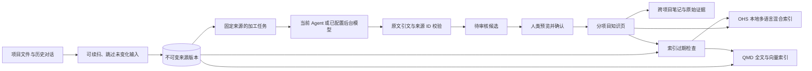

# 持续加工、审核与证据回溯

2026-10-14。本轮开发在知序已有来源账本与人工审核边界上完成以下流程：

后续扫描与检索优化已完成更新，最新口径见 [向量检索与按需读取设计](RETRIEVAL_VECTOR_DESIGN_2026-10-14.md)。BaoSteel 与天枢的支持格式扫描和文件／会话摘录语义索引已完成；细块直接向量召回已上线，首批覆盖为部分完成。

## 使用入口

“项目知识加工 → 检索与 Claudian → 持续加工”提供按项目的持续采集、自动准备任务、自动索引和自动提炼开关。后台轮询由本地 HTTP 或 MCP 服务运行，进程锁避免多个入口重复执行。服务退出后停止运行，配置与任务仍保存在 SQLite 中。

持续采集默认关闭；项目采集输入不会因为本轮开发自动上传给新服务。自动提炼仅在模型设置已启用时执行。可选后台提供方为 OpenAI 兼容接口或本机 Codex CLI；CLI 使用现有登录与提供方配置，在临时目录、只读模式运行，禁用 shell、插件、MCP、网页搜索及 hooks。不会继承项目文件中的指令。输入按配置限制，调用受每日预算约束。

本轮为四个项目显式执行了首批 CLI 提炼验证，产生的候选均等待人工审核。它没有启用全局后台模型，也没有把自动提炼等同于自动发布。

BaoSteel、天枢12345热线、职业、AI_AgentCourse 各 4 项候选，共 16 项；原始来源与目标目录已绑定。机器可读结果为 `work/knowledge-integration/pipeline-verification.json`。

## 状态与失败恢复

- 文件扫描每轮最多检查 2,500 个文件并读取 64 MB，记录续扫位置。完整清单改变时重新开始；清单稳定时下一轮继续。mtime / 大小未变化的文件跳过读取。完整清单用于判定文件删除，避免将批次外材料误标失效。
- 支持 UTF-8、带 BOM 的 UTF-16，以及 GB18030 文本。历史会话流式读取，跳过超过 2 MB 的单条记录并报告；不再仅因整个工具记录文件超过 128 MB 而跳过会话。
- 加工任务显示 `needs_agent / running / error / submitted`，失败任务保留证据和错误，支持显式重试。未提交的任务会保留来源占用，避免后台反复生成相同批次。
- `submitted` 只表示提交审核。界面另显示发布、丢弃数量和审核完成状态，暂缓与冲突不计为完成。
- QMD 与 OHS 保存实际索引指纹；来源或知识页变化后提示过期，检索仍明确返回实际参与的引擎。启用自动索引后下一轮刷新，已有 QMD 混合模式会保留语义索引。

## 证据链

审核“来源依据”页可读取不可变快照，显示 locator、完整 SHA-256、当前或历史版本。知识检索结果提供“追溯原始证据”，可继续沿已登记跨项目关联回到目标笔记的原始快照。递归结果有深度与环检测。

证据归属跟随实际写入日志的目标路径，包含审核时改名的笔记。审核后手动修改的笔记会提示当前内容与已审核版本不同。被新版本替换的来源仍能回读，删除或撤销的目标不会被当作已发布知识。

Agent MCP 新增 `get_note_evidence`、`get_proposal_evidence`。只提供读取；没有增加 Agent 审批能力。

## 检索验证与限制

OHS 已在知序现有知识页上使用 `local:Xenova/multilingual-e5-small` 建立 384 维嵌入并实际命中，无回退警告。Windows 上修复了旧投影数据库恢复远程端点，以及重建时尝试删除打开数据库的问题。OHS 投影可重建，不影响原始材料或 Vault 内容。

QMD 的 embeddinggemma 模型已缓存，职业与 AI_AgentCourse 已建立语义索引并实际执行全文和向量融合查询。BaoSteel 已建立 152,747 个原始片段全文索引、17,346 份文件／会话摘录语义文档；天枢分别为 26,143 和 2,393。两项目文件摘录缺失向量均为 0。另分别完成首批 814 和 787 个细检索块向量化；细块整体覆盖仍为 partial，不能将文件摘录 hybrid 等同于完整细块语义覆盖。

PDF、Office 解析尚未包含在本轮；大项目当前支持文本格式与可归属历史会话的可续扫描已完成。后台配置、失败重试及关键边界都有测试覆盖。

验证：105 项 Python 测试通过，Ruff、前端 TypeScript / Vite 构建及 Oxlint 通过；浏览器实际读取候选原文快照，桌面与手机尺寸无横向溢出。交叉项目写入、审核改名与历史证据回读在隔离测试库验证，真实候选未代替用户审批。

Claudian 的 Provider 配置和共享 Vault 项目选择指引已有准备，Codex CLI 自定义目录的缺失字段已修复并通过真实调用。目录原文件备份为 `relay-mrijargo.json.before-library-repair`。Obsidian 已更新到官方 Windows 安装版 1.14.4，安装包 SHA-256 与 Dynalist 签名均已校验，Claudian 的最低版本阻塞已解除。桌面控制连接仍未完成实际对话验证，因此 Claudian 端到端实测仍未完成。
