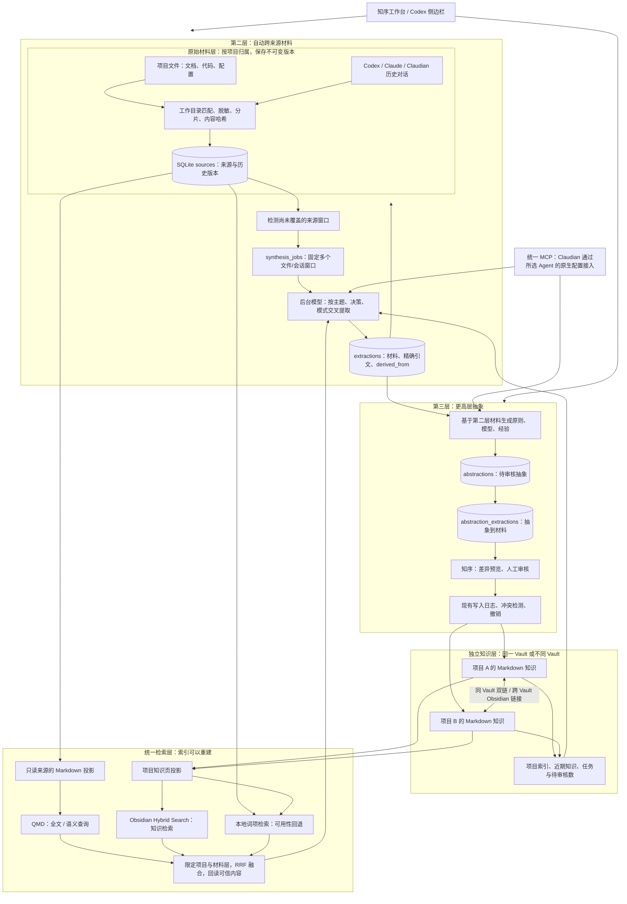

# 原始快照 → 跨来源材料 → 可追溯抽象

实现日期：2026-10-15。本文描述当前三层知识链；持续加工、证据回溯及本轮检索验证见 `CONTINUOUS_KNOWLEDGE_PIPELINE.md`，最新运行记录见 `work/knowledge-integration/pipeline-verification.json`。

本次把 obsidian-wiki 的“原始材料、来源账本、增量加工、检索、项目记忆”流程接到知序现有的审核与写入日志之上。核心约束是：第一层永远只读；第二层跨文件和跨会话自动归纳材料，不为每个来源生成一条笔记；第三层只在第二层之上做更抽象的归纳，并沿证据链回到第一层。没有把上游整套应用复制进来，也没有让多个 Agent 分别维护互不相通的知识库。



## 数据和目录

| 对象 | 存储 | 作用 |
| --- | --- | --- |
| 项目 | SQLite `projects` | 显式项目根目录、Vault、可写范围 |
| 原始材料 | `sources` | project_id、locator、revision、active、脱敏文本与来源位置；不覆盖旧版本 |
| 第二层任务 | `synthesis_jobs` | 固定多个来源窗口；自动处理状态、重试和进度 |
| 第二层材料 | `extractions`、`extraction_evidence` | 跨文件/会话的主题、决策、模式及精确引文；不直接进入审核队列 |
| 第三层抽象 | `abstractions`、`abstraction_extractions` | 基于第二层材料生成原则、模型、经验；提交后进入现有审核队列 |
| 兼容加工任务 | `builds` | 旧的显式逐批加工入口，保留用于维护，不是自动管线的默认路径 |
| 证据 | `knowledge_evidence` | 审核候选到来源版本的可追溯关系 |
| 跨项目关系 | `knowledge_relations` | 候选来源项目、目标项目、目标笔记；审核应用后才出现在知识图谱 |
| 最终知识 | `Library/Projects/<项目 ID 前12位>/concepts/*.md` | 各项目独立目录，使用原有 Vault 写入控制 |
| 可重建索引 | `.library/retrieval/<项目ID>/{raw,knowledge}` | QMD 和 OHS 只处理生成的投影，不能替代来源账本 |

来源采集包含支持的 UTF-8 文本文件和本地 JSONL 会话。默认会话目录为 `~/.codex/sessions`、`~/.codex/archived_sessions`、`~/.claude/projects`。按最具体的已登记项目根目录匹配 cwd；Claudian 使用 Vault 作为 cwd 时，仅在该 Vault 唯一归属一个项目的情况下自动归档。多个项目共用 Vault 时，不猜测会话归属。

只把可见的用户和助手消息作为材料；工具输出、隐藏推理和系统消息不入库。会话原文仍是不可信数据。默认忽略依赖、构建产物、隐藏文件和本地状态目录，单文件最多 8 MB，会话文件最多 128 MB，每次最多 2500 个文本文件及 5000 个会话文件。PDF、Office 文档和图片尚未接解析器。上限与读取失败会显示在采集结果中。

## 一次真实加工

1. 在“项目与设置”登记项目根目录和 Vault。可共用一个 Vault，也可每项目一个 Vault。
2. 在“项目知识加工”采集文件与历史对话；采集只新增来源版本，不覆盖既有快照。
3. 自动管线按来源窗口创建 `synthesis_jobs`，固定多个文件/会话的上下文。模型按主题、决策或反复出现的模式提取第二层材料；没有足够证据时返回空列表。
4. 第二层材料保存精确引文和来源 ID，自动校验引文必须来自固定窗口。它们不是逐来源笔记，也不需要人工审核或直接写文件。
5. 用户或自动管线准备第三层抽象。抽象只能引用第二层 `extraction_ids`；系统继承其来源引文，生成 `abstractions` 后才进入现有审核队列。
6. 人工在审核队列查看并保存第三层候选。保存后的知识仍可通过 `trace_knowledge_layer` 从抽象回到材料，再回到第一层原始快照。
7. 原始材料变化后重新采集新版本；旧快照、已生成材料和历史审核记录不被覆盖。采集、自动提取和索引也可以由按钮、MCP 或后台管线触发。

后台模型需要在项目设置中启用。未启用时，系统仍会准备并持久化第二层任务，等待当前 Agent 或之后的模型执行；不会把“已创建任务”误报为“已完成知识生成”。

## 检索与关联

`search_knowledge(query, project_ids, layer, engine)` 支持当前项目或多个项目、`raw/knowledge/all`、`auto/local/qmd/ohs`。不指定项目时搜索全部正式项目，排除合成演示项目。QMD 检索来源投影，OHS 检索知识投影，按 RRF 合并排名。外部引擎只提供候选路径；正文必须回读已登记来源或当前知识页，忽略未知路径。

索引未就绪或命令失败时保留本地词项检索，并返回实际参与的引擎和诊断信息。语义模型未下载成功时不能宣称混合检索已就绪。QMD 默认建立全文索引，语义索引是独立步骤；OHS 建完索引后检查实际笔记数与嵌入状态，不能仅凭退出码 0 判断成功。

同 Vault 关联写为包含完整路径的 `[[双链]]`，跨 Vault 写为 `obsidian://open` 链接。后者会在知序统一关系图中表示，但不会变成 Obsidian 自带图谱中的跨 Vault 边。历史公共笔记保留原位置，后续生成内容默认进入项目命名空间。

## Claudian 接入

已按 `realclaudian` 2.3.20 的原生 Provider MCP 设计准备接入。Claudian 是 Obsidian 中的对话入口；知识账本、检索与审核仍由本地服务提供。

`uv run library knowledge-integration <项目ID> --install` 会在目标 Vault 合并 `.mcp.json`、`.codex/config.toml`，并写入 `AGENTS.md` / `CLAUDE.md` 的受管理指引块；保留无关配置、备份原文件。遇到同名但不同内容的 MCP 配置时停止覆盖。正常的 Provider 项目信任仍由 Provider 管理。

Claudian 配置使用 `mcp --agent-only`，不注册侧边栏的人类审批工具。其内建文件系统工具仍具备自身的能力，不能把本服务的审核控制误认为整个 Claudian 的操作沙箱。

当前 Vault 已放入 Claudian 插件文件与 Provider 配置。需要在兼容的 Obsidian（插件声明最低版本 1.13.0）中启用插件、选择已登录的 Provider，重新启动会话后才能确认实际连接。尚未完成 Obsidian 内 Provider 对话实测。

## 运维与源码入口

```powershell
uv run library status
uv run library scan <项目ID>
uv run library build <项目ID>
uv run library index <项目ID> --engine qmd
uv run library index <项目ID> --engine qmd --semantic
uv run library index <项目ID> --engine ohs
uv run library search "查询" --project <项目ID> --layer all
uv run library knowledge-integration <项目ID> --install
```

搜索依赖固定为 `@tobilu/qmd@2.8.3`、`obsidian-hybrid-search@0.16.2`，锁文件在 `search-runtime/`，Windows 安装脚本为 `scripts/install-search.ps1`。首次语义索引需要下载模型，安装 npm 包并不代表模型已就绪。

本次 npm audit 报告 12 条依赖漏洞，其中 2 条 critical、5 条 high；固定版本暂无可直接应用的修复。主要涉及 QMD 的 simple-git / node-llama-cpp 依赖链和 glob 模式解析。本适配层不暴露 Git 操作、构建命令或用户自定义 glob，且显式指定自管索引，避免加载项目目录的 QMD 更新钩子；这不表示依赖漏洞已修复。完整报告保存在 `work/knowledge-integration/npm-audit.json`。

实现入口：`knowledge.py`、`retrieval.py`、`integration.py`、`mcp_server.py`、`api.py`、`frontend/src/Knowledge.tsx`。新增测试覆盖来源版本、对话路由、证据绑定、跨项目关系、审核边界和引擎回退。

后续扩展点：文档解析器、常驻增量监听、共享 Vault 会话的显式项目归属、对旧知识的冲突/过期检测、审核后的自动增量索引，以及对提炼任务的可选后台模型执行。
