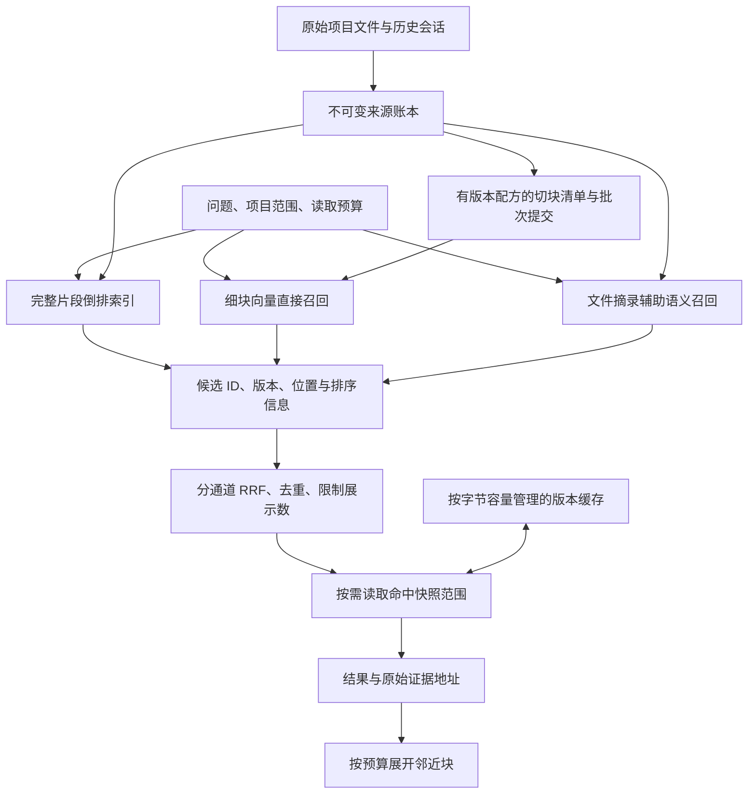

# 向量检索与按需读取设计

2026-10-14，基于 BaoSteel 与天枢的真实来源账本。分页用于来源浏览；检索通过倒排索引和向量召回定位内容，缓存不限制材料的检索资格。

## 三层块与两条直接召回通道

| 层次 | 当前实现 | 地址与边界 |
|---|---|---|
| 存储块 | 已扫描的不可变快照片段，通常上限 12,000 字符 | `source_id、revision、origin、part`；保留原审核依据 |
| 检索块 | 自然边界优先，上限 1,800 字符，重叠 160 字符 | 独立 `block_id`；父文件、章节标签、快照字符及行范围 |
| 展示与上下文块 | 排序后的命中摘录，允许有限邻近展开 | 默认每结果最多 6,000 UTF-8 字节，全次最多 36,000 字节 |

细块直接向量召回与完整片段全文召回并行，不先通过文件摘要筛掉细块。原来的开头、中部、结尾文件摘录向量作为第三条辅助通道，不能表示正文所有细节都有语义覆盖。

现阶段细块在已有不可变存储片段内部划分。跨存储片段的完整父章节、跨消息的主题识别、跨文件函数解析属于下一阶段；不宣称已经实现完整 AST 或对话主题聚类。

## 查询路径已落地的变化

1. 索引状态使用写入时更新的来源／知识代次标记，查询不再遍历全部来源 ID。旧索引清单用“构建时间与变更时间”兼容检查，首次新建索引采用 `fingerprint_schema=2`。索引构建开始时捕获来源代次，构建期间再发生修改会正确显示过期。
2. QMD 文件名直接解析来源 ID，再进行项目与当前版本验证；删除了查询时读取完整来源映射的步骤。映射文件仍保留兼容旧工具，但检索不使用它。
3. 新来源使用 SQLite FTS5 无正文索引，按项目 scope 与内容词项召回；已有大项目直接使用现成 QMD 完整片段倒排索引，避免为了上线查询优化先重复索引数 GB 文本。知识页单独维护 `note_catalog/note_fts`，在扫描、索引或审核写入后更新；查询不枚举 Vault。
4. QMD 候选适配器不读取 `content.doc`。本地 FTS、文件向量、细块 FTS 和细块向量各自排名后融合。只有胜出的结果会读取原始快照摘录；外部引擎正文不作为可信证据。
5. `candidate_limit` 控制每项目、每召回通道候选数，`limit` 控制展示数，`read_limit` 控制展开正文数；`max_bytes/per_hit_bytes` 控制总字节及单条字节。`read_limit=0` 返回轻量候选。
6. 正文缓存默认为进程内 32 MiB，键绑定 ID、来源版本、查询与摘录预算。缓存按内容、键与固定开销的字节估计淘汰，不按文件数淘汰；旧版本不会进入当前来源召回。查询向量另有 4 MiB 磁盘缓存，绑定模型文件状态、模型配方和查询。
7. 每次返回实际候选数、正文读取数、缓存命中、返回字节、耗时，以及 QMD 比较的向量数。这里的字节上限约束返回正文和应用加载；SQLite 内部读取 JSON 快照、倒排索引页及操作系统缓存仍可能产生更多逻辑 I/O。

知识页命中时只读取预算内的文件头部；文件大小/mtime 与目录清单不同会报告索引过期。完整快照哈希仍用于审核和证据校验。知识页关键词所在正文的定位窗口还需继续完善。

## 初建、续建与覆盖口径

细块清单由 `source_id + 切块配方 + 范围` 决定 ID。每批来源的所有块和完成标记共同提交；失败后重复执行不会重写审核证据，也不会丢失已生成的 QMD 向量。已有批次尚有缺失向量时，优先补完该批，不追加新来源制造积压。索引和向量检查成功后才更新覆盖状态。失效快照的块在下一次维护中撤销投影，查询也实时过滤非当前版本。

已完成的全量扫描针对当前支持的文本格式和可归属历史会话；超过读取上限、链接类文件以及 PDF/Office 等未支持格式按扫描报告保留排除原因。

| 项目 | 完整片段全文索引 | 文件／会话摘录语义文档 | 文件摘录缺失向量 | 已切块的原始片段 | 细块数 | 首批细块缺失向量 |
|---|---:|---:|---:|---:|---:|---:|
| BaoSteel | 154,106 | 17,432 | 0 | 200 / 154,106 | 1,573 | 0 |
| 天枢12345热线 | 26,149 | 2,399 | 0 | 200 / 26,149 | 1,602 | 0 |

QMD 内部还可能把一个检索块分成多个模型 token 块，故向量数可以大于检索块数。两项目首批细块实际分别为 1,928 和 1,040 个向量。**细块语义覆盖目前为 partial**；文件摘录 hybrid 与细块 complete 是不同状态。

HTTP `POST /api/projects/{project_id}/retrieval/chunks` 接受 `batch_size` 与 `semantic`；面板提供每次 100 个原始片段的续建入口。Agent 的 `read_retrieval_block` 只读指定项目的有效块，可以展开最多两个邻近块。Agent 没有新增审批权限。

命令行同样可恢复续建，例如 `uv run python scripts/build-fine-index.py BaoSteel --batches 10 --batch-size 100`。每次检查真实未生成向量数量，批次记录存于本地状态库；不把进程成功退出作为完整覆盖的唯一依据。

## 测量与质量核对

记录位于 `work/retrieval-optimization/`。`benchmark-retrieval.py before/after` 使用同样三个问题和同一份来源库，分别执行新进程首次查询与重复查询。未清空操作系统缓存，因此“首次查询”不等于物理磁盘冷启动。Windows `ReadTransferCount` 是进程逻辑读取量，不能当作磁盘设备实际读取量。

以下为加入首批细块后的最终一轮本地 FTS 查询结果，括号前后为首次／重复：

| 问题 | 优化前秒 | 优化后秒 | 前／后首次逻辑读取 | 前／后测试进程峰值 |
|---|---:|---:|---:|---:|
| BaoSteel：物理约束 | 8.50 / 8.38 | 0.36 / 0.31 | 2.096 GB / 181 MB | 134 MB / 46 MB |
| BaoSteel：TSC 碳温监督 | 0.58 / 0.60 | 0.65 / 0.50 | 176 MB / 239 MB | 同一测试进程累计峰值 |
| 天枢：知识库检索 | 2.63 / 1.94 | 0.11 / 0.10 | 436 MB / 52 MB | 同一测试进程累计峰值 |

首次查询受当时索引维护与操作系统页缓存影响，单次数字不能视为稳定 SLA。前一轮首次 BaoSteel 查询曾分别测得 2.89 和 1.74 秒。TSC 查询最终一轮首次延迟与读取量仍变差，说明增加分通道召回不保证每个问题都有性能收益。

包含文件摘录与首批细块的混合查询实测：BaoSteel 首次约 18.0 秒，重复约 4.6 秒；天枢首次约 9.9 秒，重复约 1.3 秒。首次包含模型加载／查询向量生成；重复命中向量缓存。两项目均实际命中细块与 QMD，原始快照 ID 和字符范围有效，无引擎回退警告。

最终加入按原始来源去重后，已有查询向量缓存的一轮分别测得 BaoSteel 11.65 / 5.04 秒、天枢 2.89 / 1.45 秒。两者首次正文缓存为空，重复均命中 8 条正文缓存；细块分别命中 6 与 3 条。此记录为 `hybrid-verification-final.json`。

人工根据已有文件名选择的三个关键证据检查全部命中前八条：PINN 相关材料、TSC 碳温监督字段映射、12345 hotline agent。另保存了旧前八条在新前八／前四十条的重叠；其中两个 BaoSteel 问题排序差异很大。旧结果重叠不是召回率，三个证据锚点也不是完整 gold set，不能据此宣称整体检索质量无退化。正文内部罕见关键词、项目隔离、版本退休、邻近展开、预算和缓存边界有独立回归测试。

## 下一阶段的具体决策

- 全量细块向量化保留逐批续建。先将批次选择改为文档均衡，优先覆盖全部人写文档，再扩展数据表；未处理材料仍有完整全文直接入口。初次全量覆盖的总工作量无法被分页免除。
- 当前适配器执行明确的集合内精确余弦比较，向量按 400 个一批读取，并只保存有限最优候选。降低峰值内存不会降低总距离计算量。集合越来越大时，先记录 p50/p95、比较向量数和 CPU/模型/I/O 各阶段耗时，再评估 HNSW；用同一人工证据集合验证 Recall@k、MRR、nDCG 和各项目召回，不能把上游命名为 ANN 的分支直接视为 HNSW。
- 查询向量缓存已经减少重复模型启动；常驻模型服务尚未引入。是否驻留应根据首次查询频率、GPU 占用和空闲回收预算决定。
- 当前边界是字节／字符预算。模型上下文 token 必须按所选模型 tokenizer 在最终组装时另计；不把字符数或字节数冒充实际 token 数。调用方应包含系统提示、问题、输出预留和邻近展开预算。
- 轻量检索清单与索引已分离；原审核快照仍存于历史 `sources.data` JSON。将大正文迁到独立 blob 表、给所有文档统一全局行范围、跨存储片段章节展开及知识页窗口定位，需要保留旧 ID 和证据兼容的迁移，再进一步减少底层页读取。

Obsidian 已更新到官方 Windows 安装版 1.14.4，安装包哈希和签名已校验。Claudian 的最低版本阻塞解除，Obsidian 内实际对话仍未验证。

面板有 15 秒数据刷新、版本提示及带构建版本的 MCP 资源。代码更新后的旧 Codex 页面需要重新连接插件并关闭重开；这不等同于开发服务器 HMR。当前前端构建为 `83f6ad49e5f0`。

验证：119 项 Python 测试通过，Ruff、前端 TypeScript/Vite 双构建与 Oxlint 通过。桌面与 390px 手机宽度已检查；面板的整页 tooltip 遮挡已修复，鼠标导航可用，无横向溢出。当前已提交的候选仍待人工审核。
